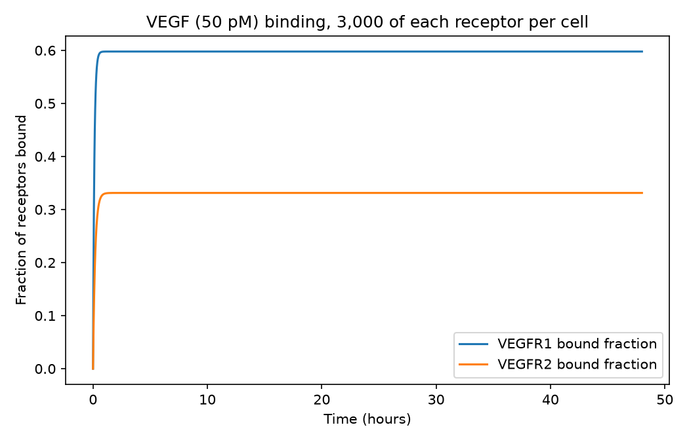
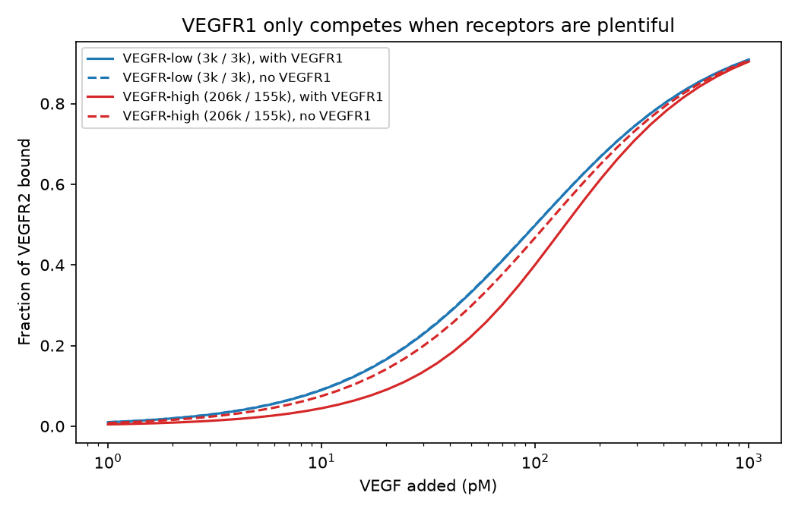
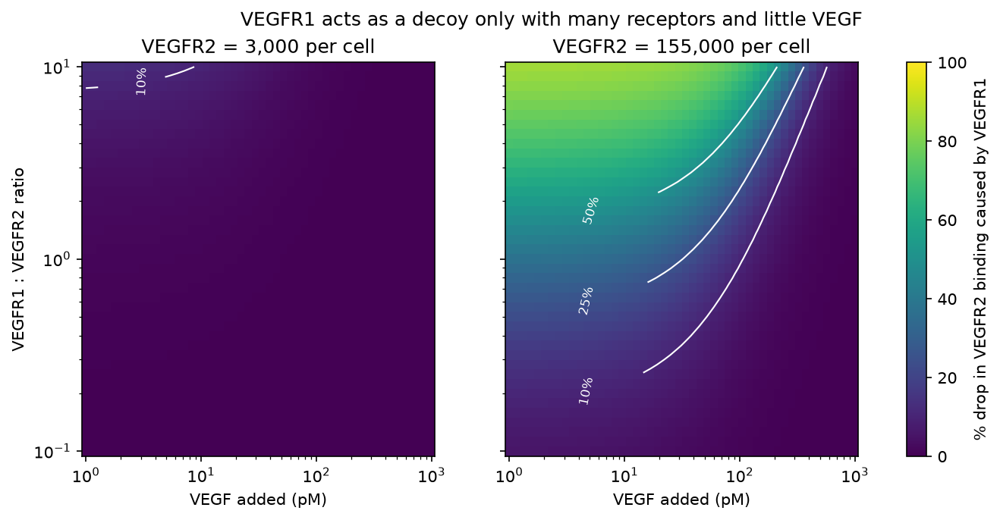
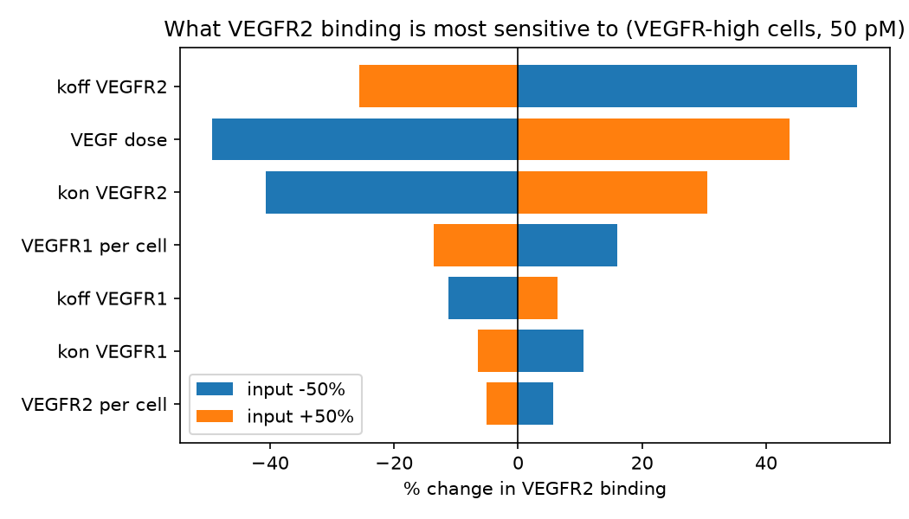
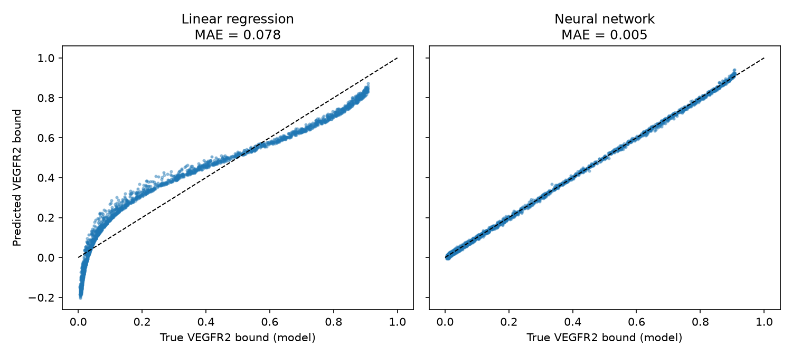

# VEGF Receptor Competition Model

A simplified Python model of how VEGF binds its two main receptors, VEGFR1 and VEGFR2, using receptor counts measured on human circulating endothelial cells by the Imoukhuede lab.

**Question:** When does VEGFR1 act as a "decoy" and pull VEGF away from VEGFR2, the receptor that drives blood vessel growth?

**Short answer:** Only when cells have lots of receptors and VEGF is scarce. In VEGFR-low cells, VEGFR1 barely changes VEGFR2 binding (0 to 1%). In VEGFR-high cells at low VEGF, it lowers VEGFR2 binding by up to 43%, and by up to 86% when VEGFR1 heavily outnumbers VEGFR2.

This project reproduces and explores a simplified version of models that have already been published (see References). It is a learning and skills project, not a new biological finding.

---

## Background

- **VEGF** (vascular endothelial growth factor) signals endothelial cells to build new blood vessels (angiogenesis)
- **VEGFR2** carries the main pro-growth signal
- **VEGFR1** binds VEGF about 3x more tightly but signals weakly, so it can act as a decoy
- Tumors depend on new blood vessels, which is why anti-VEGF drugs exist. They don't work for every patient
- The Imoukhuede lab measures exact receptor numbers per cell and has shown that using measured counts instead of estimates can change model predictions by up to sixfold

## The model

Two reversible binding reactions share one pool of VEGF:

```
VEGF + VEGFR1 <-> VEGF:VEGFR1     (kon1, koff1)
VEGF + VEGFR2 <-> VEGF:VEGFR2     (kon2, koff2)
```

These become 5 mass-action ODEs (free VEGF, free VEGFR1, free VEGFR2, and the two complexes), solved with SciPy. The setup is a culture well with 100,000 cells in 1 mL.

**Assumptions**
- One VEGF binds one receptor (no dimerization)
- No NRP1 co-receptor, no receptor internalization or synthesis
- Well-mixed dish, not tissue

## Data

| File | Type | What it is |
|---|---|---|
| `data/vegf_parameters.csv` | **Real input data** | Every parameter value, with its source. Binding constants from Stefanini et al. 2008, receptor counts from the Imoukhuede lab |
| everything else in `data/` | **Simulated** | Generated by `main.py` from the parameters above. Can be fully regenerated |

No experimental data was collected for this project.

## Code structure

| File | What it does |
|---|---|
| `vegfr_model/parameters.py` | Loads `data/vegf_parameters.csv` into a `Parameters` object (unit conversion, Kd) |
| `vegfr_model/binding.py` | The 5 mass-action ODEs (`simulate`), the direct steady-state solution (`equilibrium`), and VEGFR2 binding / VEGFR1 decoy effect |
| `vegfr_model/analysis.py` | Model validation, dose response, competition map, sensitivity analysis |
| `vegfr_model/surrogate.py` | Training data generation and the neural network vs linear regression comparison |
| `vegfr_model/plots.py` | Figures |
| `main.py` | Command-line entry point that runs the analyses and saves results |
| `tests/test_binding.py` | Automated checks of the model (see Tests) |

**Analyses** (`python main.py <command>`)

| Command | What it does | Output |
|---|---|---|
| `validate` | Solves the full ODE for VEGFR-low cells and checks it against the equilibrium solution | `timecourse.csv`, `binding_timecourse.png` |
| `dose-response` | VEGFR-low vs VEGFR-high cells across VEGF doses, with and without VEGFR1 | `dose_response.csv`, `dose_response.png` |
| `competition-map` | VEGFR1's decoy effect across VEGF dose and VEGFR1:VEGFR2 ratio | `competition_map.csv`, `competition_map.png` |
| `sensitivity` | Changes each input by ±50%, one at a time | `sensitivity.csv`, `sensitivity.png` |
| `surrogate` | Simulates 10,000 cells and doses, trains a neural network, compares it to linear regression | `training_data.csv`, `surrogate_scores.csv`, `surrogate_test_predictions.csv`, `surrogate_fit.png` |

Sweeps use the equilibrium solution, which `validate` shows matches the full ODE to 15 digits.

## Results

### Model validation
- Mass balance error about 1e-16 (numerically zero)
- ODE end state matches the equilibrium formula (VEGFR2 bound fraction 0.33127 for both)



### VEGFR1 only competes in VEGFR-high cells

| Cells | VEGF dose | Drop in VEGFR2 binding caused by VEGFR1 |
|---|---|---|
| VEGFR-low (3k / 3k) | 5 pM | 1% |
| VEGFR-low | 50 pM | 0% |
| VEGFR-high (206k / 155k) | 5 pM | 43% |
| VEGFR-high | 50 pM | 25% |
| VEGFR-high | 500 pM | 1% |



### The decoy effect needs many receptors and little VEGF
- VEGFR2 at 3,000 per cell: maximum effect 13%
- VEGFR2 at 155,000 per cell: maximum effect 86%



### VEGFR2's own binding and VEGF dose matter most
- Largest effects: koff of VEGFR2 (+55% / -26%), VEGF dose (-49% / +44%), kon of VEGFR2 (-41% / +31%)
- VEGFR1 count has a smaller effect (+16% / -14%)
- kon and koff only matter through Kd = koff / kon at equilibrium



### A neural network reproduces the model

| Model | Test MAE | Test R² |
|---|---|---|
| Linear regression | 0.078 | 0.916 |
| Neural network (2 x 64, scikit-learn) | 0.005 | 0.9996 |

Linear regression can't follow the S-shaped binding curves. The neural network is a surrogate for a model that is already fast, so it demonstrates ML skills rather than adding new science.



## How this compares to published work

- Mac Gabhann & Popel (2004) found that shifting VEGF from VEGFR1 to VEGFR2 changed VEGFR2 signaling only modestly under normal conditions
- Clegg & Mac Gabhann (2017) found receptors in the body are only 3 to 9% occupied, so there is little competition
- My VEGFR-low results agree with both. My VEGFR-high results show where competition starts to matter
- This is a qualitative match in the overall pattern, not a number-by-number comparison, since those models include more biology

## Limitations

- No receptor dimerization, NRP1, internalization or synthesis
- A dish, not a body. Different cell numbers or volumes would change the exact values
- Binding constants come from one source, and published values vary
- Results are qualitative, not real biological predictions

## Tests

`tests/test_binding.py` checks that the model behaves correctly:

- total VEGF and receptors are conserved during the simulation
- the ODE end state matches the directly solved equilibrium
- with no VEGFR1 and excess VEGF, binding follows L / (Kd + L)
- no VEGFR1 means no decoy effect
- adding VEGFR1 never increases VEGFR2 binding
- scaling kon and koff together leaves the equilibrium unchanged (only Kd matters)
- the decoy effect is larger in VEGFR-high than VEGFR-low cells

## How to run

Requires Python 3.

```bash
pip install -r requirements.txt
pytest                         # run the tests
python main.py                 # run every analysis
python main.py sensitivity     # or run one analysis
```

Everything in `data/` (except `vegf_parameters.csv`) and `figures/` is regenerated by `main.py`. Random seeds are fixed, so results are identical each run.

## Folder layout

```
vegfr/
  README.md
  requirements.txt
  main.py
  vegfr_model/
    __init__.py
    parameters.py
    binding.py
    analysis.py
    surrogate.py
    plots.py
  tests/
    test_binding.py
  data/
  figures/
```

## Acknowledgments

Code was developed with help from AI coding tools.

## References

1. Stefanini MO, Wu FTH, Mac Gabhann F, Popel AS. A compartment model of VEGF distribution in blood, healthy and diseased tissues. *BMC Systems Biology* 2:77 (2008). [Parameter table](https://bmcsystbiol.biomedcentral.com/articles/10.1186/1752-0509-2-77/tables/2)
2. Imoukhuede lab, receptor quantification on circulating endothelial cells. [NSF PAR record](https://par.nsf.gov/search/author:%22Imoukhuede,%20P%22)
3. Imoukhuede PI, Popel AS. Quantitative fluorescent profiling of VEGFRs reveals tumor cell and endothelial cell heterogeneity in breast cancer xenografts. *Cancer Medicine* (2014). [Link](https://pmc.ncbi.nlm.nih.gov/articles/PMC3987073)
4. Imoukhuede PI, Popel AS. Quantification and cell-to-cell variation of vascular endothelial growth factor receptors. *Experimental Cell Research* (2011). [Link](https://pmc.ncbi.nlm.nih.gov/articles/PMC3073416)
5. Mac Gabhann F, Popel AS. Model of competitive binding of vascular endothelial growth factor and placental growth factor to VEGF receptors on endothelial cells. *Am J Physiol Heart Circ Physiol* (2004). [Link](https://read.qxmd.com/read/12714333/model-of-competitive-binding-of-vascular-endothelial-growth-factor-and-placental-growth-factor-to-vegf-receptors-on-endothelial-cells)
6. Clegg LE, Mac Gabhann F. A computational analysis of in vivo VEGFR activation by multiple co-expressed ligands. *PLoS Computational Biology* (2017). [Link](https://pmc.ncbi.nlm.nih.gov/articles/PMC5378411)
